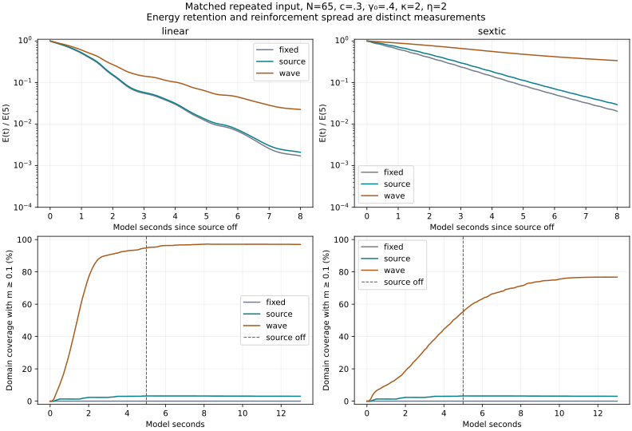
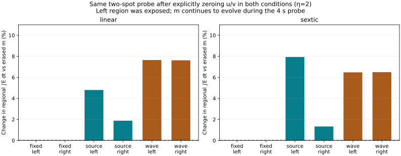
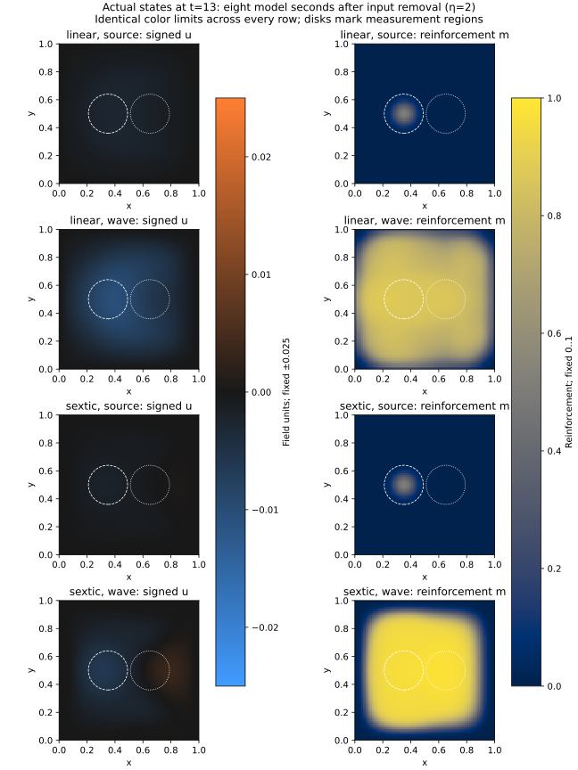

# Issue #10 — activity-dependent damping and history-dependent response

2026-11-05 · [Issue #10](https://github.com/mongstad/SENTIO/issues/10) · isolated research, owner review

## Result and scope

An explicit local reinforcement map can produce measurable history-dependent
responses by reducing dissipation. In the nominal source-driven model, a later
identical probe delivered **4.80% more regional time-integrated wave energy in
linear mode and 7.94% more in sextic mode** in the previously exposed region,
compared with erasing the reinforcement map. Both probe conditions began with
zero amplitude and velocity, so leftover wave energy does not explain this
difference. Reflecting the training location reflected the response bias.

This is a phenomenological damping history carried by a **second state m**. It
does not establish single-scalar memory, learned content, recognition, or a
biological mechanism. Nominal repeated exposure did not improve the probe more
than a matched recent single pulse. Source polarity is discarded by both
activity definitions. A novel equal-exposure dipole also changes the response;
the experiment does not demonstrate a preference for the familiar shape.

The nominal wave-driven rule retains substantially more energy, but reinforces
**96.97% of grid nodes in linear mode and 76.76% in sextic mode** above m=.1.
Its later response is nearly the same in both probe regions. A separately
declared slower-rate follow-up produces a more graded spatial bias; it also
shows that probe-induced reinforcement changes the retained/erased contrast.
These distinctions matter more than the appearance of persistent oscillations.

The owner explicitly activated the issue's backlog gate in this implementation
request. Following issue #3's research convention, all implementation is under
`research/issue_10/`, with independent tests and a synthetic Qt viewer. The
accepted `sentio` implementation, CLI, camera path, numeric controls, defaults,
checkpoint schemas, dependencies and previous evidence are unchanged. COGNIO
and WVZ interfaces are untouched. No webcam trial or production model-registry
integration is claimed or required to run this research viewer.

## Equations and numerical contract

The wave equation uses the accepted stencil and either V=0 or the accepted
soft-sextic potential (ω=8, amplitude scale A=.1):

```text
u_t = v
v_t = c² Δu − [γ(m)+σ(x,y)]v − V'(u) + κS
m_t = η a(u,v,S) (1−m) − λm
γ(m) = γ_min + (γ₀−γ_min)/(1+αm)
```

The domain is the unit square with fixed u=v=0 edges and the unchanged sponge σ.
There is no diffusion or transport term for m. Wave-driven reinforcement spreads
because waves transport energy to other locations. The map is dimensionless;
η, λ and γ have inverse-model-second units; α is dimensionless. The baseline
parameters are c=.3, γ₀=.4, κ=2. Nominal reinforcement parameters are η=2,
λ=.02, α=9, γ_min=.02. All three state arrays start at zero.

| Activity definition | Meaning and scale |
|---|---|
| Source: a=(κS/F₀)², F₀=2 | Squared applied acceleration relative to a fixed reference. It is zero without input or when κ=0. It is not inferred optical energy. |
| Wave: a=e/(e+e₀), e₀=.005 | Bounded local wave energy density: kinetic + gradient + sextic potential where applicable. It can reinforce unforced waves and their propagation paths. |

The gradient density assigns half of each edge's energy to each endpoint, so
`dx² sum(e)` is the accepted discrete wave energy. Both definitions are
nonnegative and invariant under simultaneous sign reversal of u/v/S. They use
different explicit scales; equal η does not imply equal activity dose. No
spatial template, source classifier, display value or optimization target enters
the evolution rule.

For frozen activity, r=ηa+λ and q=ηa/r, the exact map update is
`m_new=m exp(−rh)+q[1−exp(−rh)]`; when r=0 it leaves m unchanged. A stable `expm1`
evaluation retains slow updates. This is a convex update, with explicit [0,1]
validation and no clipping. One step consists of an m half-update at the old
wave state, a damping/Verlet wave step using that midpoint map, and an m
half-update at the new state. The symmetric split's accuracy is measured below.

Required domains are finite η,λ,α≥0, 0≤γ_min≤γ₀, and positive finite activity
scales. The effective uniform damping lies between
`γ_min+(γ₀−γ_min)/(1+α)` and γ₀; the sponge is additional and is never weakened.
For nominal α=9 the attainable lower bound is .058, not .02. The original
wave/CFL and sextic curvature step bounds, polynomial envelope, float64 clock
checks and 1e6 amplitude/velocity guard remain. Invalid candidates commit
neither u/v/m nor work/loss/clock. These guards do not prove stability for every
finite parameter combination. Settings remain fixed during each trial.

When reinforcement is disabled, the wrapper calls the actual accepted solver
for each committed step. It does not approximate a replacement baseline.
Research reset clears all three fields. Research save/load deliberately reject
application checkpoint use: an application checkpoint cannot represent m.

## Energy accounting and timescales

The mechanical energy depends on u/v, not on m. In the semidiscrete equations,

```text
dE/dt = κ dx² Σ(S v) − dx² Σ[(γ(m)+σ)v²]
```

Changing m cannot add mechanical energy; it changes its loss rate. No physical
energy cost or reservoir for maintaining m is modeled. For every held-source
step, input work is κ dx² Σ(S Δu), and damping loss is the exact kinetic loss of
the two damping substeps. `E−E_initial−work+loss` measures integration error.
It is not called a conserved quantity. Numerical energy can still have small
integration oscillations; source-off tests and refinement are therefore retained.

“Slow” requires a specified comparison. Nominal map relaxation can be as short
as 1/(2+.02)=.495 s for wave activity and about 1.92 s at the .5 source peak.
That is not uniformly slower than a small-amplitude ω=8 period (~.785 s).
The explicit follow-up η=.05/.2 has minimum wave-map times of 14.3/4.55 s and
source-map times of 30.8/14.3 s at this input peak. Its results are reported
separately; the original matrix was not replaced with favorable settings.

## Controlled histories and measurements

The [protocol](../research/issue_10/README.md) was written before the initial
matrix. A Gaussian at (x=.35,y=.5), σ=.07, its horizontal reflection, and a signed
vertical dipole have equal discrete squared norms. Training amplitude is .5.
Repeated exposure comprises four .5-second pulses at 0, 1.5, 3 and 4.5 s.
Single recent [3,5), single early [0,2), and clustered pulses have the same total
two-second on-time. Zero histories and fixed-damping controls are included.
Every discontinuity and .1 s diagnostic sample is aligned in model time to
floating-point tolerance. These inputs are deterministic, not camera frames.

At N=65 all nonzero histories supply the same squared-source exposure
`∫dx² Σ(κS)² dt ≈ .030787608`. **Actual work differs**, because forcing phase and
the evolving field differ. The report retains both quantities. A common t=5
reference is used for normalized source-off decay; the early single pulse has
already had three extra seconds without input at that point. Half crossings
are sampled .1 s crossings below half E(5) that are not exceeded again within
the recorded window; they are not fitted or extrapolated lifetimes.

After t=13, two fresh wave states are explicitly set to u=v=0. One retains the
training m, the other erases it. Both receive the same two-spot probe for .5 s,
then 3.5 s without input, with the same reinforcement rule still active. Local
energy is integrated over each of two disks of radius .14 at x=.35/.65. This
state-matching intervention is a control, not spontaneous resetting or a claim
about an unmodified ongoing sensory stream. Coupling through wave propagation
means the untrained disk is not dynamically independent of the trained disk.

Coverage is the fraction of grid nodes with m≥.1; full m means, quantiles,
regional fractions and participation are retained as well. Zero coverage at
small η does not mean zero reinforcement.

## Measured results

Nominal N=65 repeated history, eight model seconds after source removal:

| Model / rule | E(13)/E(5) | Half crossing (s) | m≥.1 coverage | Probe gain, left | Probe gain, right |
|---|---:|---:|---:|---:|---:|
| Linear / fixed | .001721 | 1.1 | 0% | 1.00000 | 1.00000 |
| Linear / source | .002107 | 1.1 | 3.03% | 1.04797 | 1.01878 |
| Linear / wave | .022530 | 1.3 | 96.97% | 1.07646 | 1.07621 |
| Sextic / fixed | .020450 | 1.6 | 0% | 1.00000 | 1.00000 |
| Sextic / source | .029483 | 1.9 | 3.03% | 1.07936 | 1.01327 |
| Sextic / wave | .336756 | 4.8 | 76.76% | 1.06474 | 1.06491 |

Probe gain is regional time-integrated energy with retained m divided by that
with erased m, not an increase in supplied work, recognition score or recovered
pattern. The source map has mean .00968 and maximum .515 at t=13. Its map is
independent of the wave model for the same forcing, up to roundoff. The nominal
wave maps have means .676/.600 and maxima .879/.979 (linear/sextic).



The source-rule left probe gains for **repeated / single recent / single early /
clustered / novel dipole** histories are:

- Linear: **1.04797 / 1.04863 / 1.04718 / 1.04838 / 1.04143**.
- Sextic: **1.07936 / 1.08067 / 1.07786 / 1.08017 / 1.08073**.

Thus recurrence itself has no special advantage in this nominal comparison.
Leak, saturation, exposure timing and spatial activity distribution explain
the stored damping map. Reflecting training swaps the left/right probe gains
to numerical precision. The novel dipole's sextic gain is slightly greater
than the familiar Gaussian's, so these data do not support shape recognition.



Slower-rate follow-up, using the same protocol and nominal remaining parameters:

| Model / activity | η | Left probe gain | Right probe gain | m max | m≥.1 coverage |
|---|---:|---:|---:|---:|---:|
| Linear / source | .05 | 1.00851 | 1.00260 | .01987 | 0% |
| Linear / source | .2 | 1.02429 | 1.00770 | .07667 | 0% |
| Linear / wave | .05 | 1.10871 | 1.09586 | .09637 | 0% |
| Linear / wave | .2 | 1.16690 | 1.15809 | .33581 | 66.70% |
| Sextic / source | .05 | 1.01242 | 1.00171 | .01987 | 0% |
| Sextic / source | .2 | 1.03602 | 1.00514 | .07667 | 0% |
| Sextic / wave | .05 | 1.18762 | 1.10891 | .19371 | 11.69% |
| Sextic / wave | .2 | 1.21922 | 1.18190 | .61558 | 50.79% |

The larger slow-wave contrast does not mean that lower η always retains more
energy. In the erased-map control, the probe itself reinforces less quickly at
small η, so its response remains more distinct from the trained-map case. This
interpretation follows from the defined rule and the matched interventions;
it is not a demonstrated information-processing function. Broader temporal and
shape controls at these slower rates were not run. Eight η=.05 refinement
trials check the observed slower-rate effects separately.
For example, the sextic erased-map probe ends with mean m=.2564 and maximum
.9014 at η=2, versus mean .00797 and maximum .04798 at η=.05. The control itself
is therefore much less reinforced in the latter comparison.
At η=.05, moving from N=65 to N=129 changes the probe ratios by at most
3.87e−4; halving h changes them by at most 7.13e−6. Those changes are smaller
than the measured effects, including the slow source rule's ~1% local response.

In the 60-second nominal runs, source-rule retention at t=60 was
4.27e−15 (linear) and 1.04e−10 (sextic), relative to E(5). Wave-rule values were
5.94e−8 and .002136. Source-map mean fell to .003783 through its prescribed
decay. Wave-map means remained .270/.353; low dissipation and ongoing wave
activity extend the history but do not sustain energy indefinitely in this
finite test. All sampled source-off energy curves decreased.



## Numerical validation and limitations

The original **116 configurations** comprise 42 history/control cases, 40
one-factor parameter variations, 24 resolution/step/boundary cases, six N=256
cases, and four 60-second cases. The declared follow-up adds eight slower-rate
cases and eight slower-rate refinement cases. Each completed configuration
also includes both four-second probes. These are deterministic comparisons,
not independent statistical samples or a Cartesian proof of a safe region.
All **132 configurations and their 264 probes completed**, with no recorded
numerical stop. The slower follow-up's balance residuals also stay below the
original matrix's maximum.

The unchanged baseline passed 75 tests. The final full suite passed **87 tests
in 10.460 s**, and the Fedora system-package run passed **87 tests in 10.480 s**,
both with zero failures/skips. `compileall` and whitespace checks passed.
Python 3.14.10, NumPy 2.4.3 / system 2.4.6, PySide6 6.11.2 and optional plotting
Matplotlib 3.10.8 were exercised. [validation.json](evidence/issue-10/validation.json)
records commands, test-log hashes and final implementation hashes.
The full comparison matrix used NumPy 2.4.3; the system NumPy environment was
covered by the test suite, not a second full matrix.

- Disabled research evolution is bitwise identical to accepted linear/sextic
  u/v and clocks at N=33/129 in unit tests and N=256 over 100 steps in the
  measurement harness. η=0, α=0 and γ_min=γ₀ controls recover fixed-damping
  responses. Zero input and zero initial wave state stay exactly zero, even
  with a fully reinforced map. Reset and candidate-failure atomicity are tested.
- At N=65, h versus h/2 errors relative to h/4 differ by ~5.00, as expected for
  second-order errors measured against a finite quarter-step reference. Maximum
  energy-balance residuals fall by ~4.00 on halving h. N=33/65 errors relative
  to common N=129 nodes fall by factors 5.01–5.20 for u/v; wave-map factors are
  4.99–5.07. The source map agrees with its exact affine solution to **5.61e−15**.
- Across the original 116 configurations, the maximum sampled balance residual
  divided by maximum cumulative work was **9.19e−5**. No .1-second source-off
  sample increased energy. Separately, a smooth unforced sine-state check
  evaluated energy every step for two model seconds; the maximum E/E_initial
  was 1.0 for both models and rules. This is bounded evidence, not a claim about
  every high-frequency state or an exactly monotone Verlet energy.
- Nominal source left-probe gains change from 1.047969 to **1.047902** (linear)
  and 1.079361 to **1.079262** (sextic) between N=65 and N=256. Halving h changes
  them by less than 2e−6. The measured history effects exceed these changes.
- Removing the sponge changes absolute persistence substantially: at N=65,
  source-rule retention becomes .05307/.05093, and wave-rule retention
  .62070/.59558 (linear/sextic). The source-rule left/right probe bias remains.
  Boundary absorption is a major contributor to lifetime; the result is not
  boundary-independent localization.
- The one-factor sweep uses η=0/.5/4, λ=0/.2, α=0/4/32 and γ_min=0/.4 around
  nominal settings, for both models/rules. Maps stayed bounded, damping remained
  nonnegative, and no numerical stop occurred. This does not authorize arbitrary
  rate combinations or prove accuracy under extreme stiffness.

Source/setting hashes, versions, final-state hashes, counters and scalar curves
are retained in [summary.json](evidence/issue-10/summary.json). The unchanged
numerical model and original protocols are in commit `26fb05c`; later driver
changes add the explicitly labeled slower-rate suites. Figure replays match
the original final u/v/m hashes exactly. Full local scalar outputs remain in
ignored `runs/issue10/`; no binary state or source-image dataset is committed.

The visible Wayland viewer was exercised with linear/source and sextic/wave
settings at N=65. Both completed training and the retained/erased probes,
preserved u/v/m during pause, reset all state, rendered separate fixed-scale
images and stopped their timers on close. Automated Qt-event runs lasted
20.16/20.32 wall seconds; screenshots were inspected locally. The field display
is intentionally faint after decay at its fixed ±.1 scale; saturation is shown.
Static figures use their separately labeled common ±.025 field scale and 0..1
map scale. No display data feeds back into either state.

No camera trial, physical keyboard/mouse ergonomics study, live large-grid
performance campaign, checkpoint import/export, single-field mechanism,
information-retrieval test, arbitrary-parameter certification, or infinite-time
stability result is claimed. Larger performance work and a camera integration
would need their own bounded scope. Keeping this as a controlled research mode
is justified; promoting it as learned sensory memory is not.

## Reproduction and owner verification

Run from the checkout root. Research is intentionally excluded from the
installed application package. Choose fresh output paths to preserve evidence.

```bash
python3 -m unittest discover -s tests -v
PYTHONNOUSERSITE=1 python3 -m unittest discover -s tests -v
python3 -m research.issue_10.experiments --suite matrix --workers 4 --output runs/issue10-owner/matrix.json
python3 -m research.issue_10.experiments --suite sweep --workers 4 --output runs/issue10-owner/sweep.json
python3 -m research.issue_10.experiments --suite refine --workers 4 --output runs/issue10-owner/refine.json
python3 -m research.issue_10.experiments --suite full_grid --workers 4 --output runs/issue10-owner/full_grid.json
python3 -m research.issue_10.experiments --suite long --workers 4 --output runs/issue10-owner/long.json
python3 -m research.issue_10.experiments --suite slow --workers 4 --output runs/issue10-owner/slow.json
python3 -m research.issue_10.experiments --suite slow_refine --workers 4 --output runs/issue10-owner/slow_refine.json
python3 -m research.issue_10.checks --output runs/issue10-owner/checks.json
# --figures alone needs optional Matplotlib, as in issue #3.
MPLCONFIGDIR=/tmp/sentio-mpl python3 -m research.issue_10.report_artifacts --input runs/issue10-owner --output runs/issue10-owner-review --figures
python3 -m research.issue_10.viewer --model linear --activity source
python3 -m research.issue_10.viewer --model sextic --activity wave
```

In the viewer, compare fixed damping, source activity and wave activity. Changing
a selector restarts all state. Pause should freeze both panels. Let training
reach t=13; then use each standard-probe button. Both reset u/v and the phase
clock; the retained button always uses the completed training map, even after
an erased-map probe. Restart clears the map too. `--shape displaced` or `novel`
and the history selector provide the spatial/timing controls. `--grid 256`
tests a larger research grid; inspect actual model/wall time instead of assuming
real time. The standalone viewer never opens the webcam.
