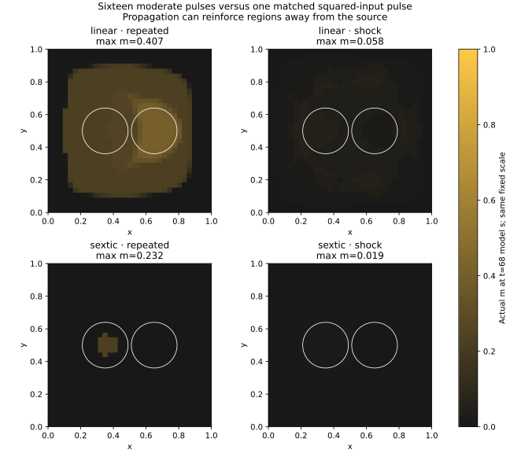
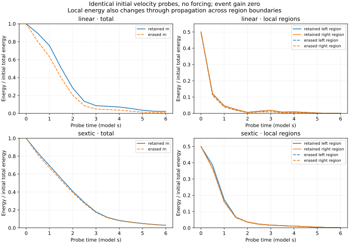

# Issue 11 — bounded reinforcement from distinct activity episodes

Issue [#11](https://github.com/mongstad/SENTIO/issues/11) authorizes an optional,
explicit second state in the accepted camera-driven application. It follows
[issue #10's continuous-activity research](ISSUE_10_REINFORCEMENT.md), but **does
not use amplitude- or energy-weighted accumulation**. The accepted wave models,
sensory conversion and signed displacement renderer remain separate.

## Owner verification

```bash
python3 -m sentio --source recurring
# After closing that window:
python3 -m sentio --source camera --model sextic
```

The normal application starts with reinforcement **OFF**, its controls collapsed,
and the accepted physical/display defaults. Expand **Experimental reinforcement
controls…**, check **Enable event-counted local damping**, and optionally show
**reinforcement m**. The small diagnostic uses a fixed dark-zero/gold-one scale;
it can look almost dark after only a few events. It never auto-normalizes, changes
wave colors or feeds pixels into the solver. Use the numeric m/event diagnostics.
The larger blue/orange image remains actual signed wave displacement.

Try **Display range** `.025` (Enter) for small synthetic/sextic waves. This is a
display choice, not a change to activity detection. The three additional Enter-to-
apply controls are activity threshold, gain per event and forgetting rate. Drafts,
rejections and Escape retain the established control behavior. Baseline **Damping**
is γ₀; the diagnostic reports the effective local damping interval plus the
unchanged sponge. All time units are **model seconds**, even if the simulation is
slower than the camera or wall clock.

Pause freezes u, v, m and the detector. Turning input coupling off removes forcing
but allows propagated arrivals, reflection, forgetting and wave evolution.
Turning reinforcement OFF freezes its entire history and restores uniform γ₀;
turning it back on resumes that history. **Reset field** clears u/v, m, event
counts, latches and clocks, retaining settings. Model changes return to model
defaults with reinforcement OFF, paused and uncoupled. The explicit sextic seed
also clears reinforcement history while retaining its settings/enabled choice;
its γ₀=0 means reinforcement cannot reduce its damping further.

To check persistence, pause and explicitly save a checkpoint, reset, then restore.
The restored wave, map and detector must match and remain paused/uncoupled. Uncheck
Pause and enable input only when ready. Comparing live camera runs cannot exactly
replay an unsaved camera stream; use the deterministic commands below for science.

## Operational definition

For each interior grid cell, define a displacement-scaled envelope:

```text
a = max(|u|, τ |v|)
τ = .1 model s
high = .005 field units; low = high/2
quiet time = .25 model s; minimum event spacing = .5 model s
```

An initially armed cell counts one event when `a ≥ high` and its refractory timer
has expired. It disarms immediately. It re-arms only after **continuous** activity
at or below `low` for the quiet time. Any intervening activity above `low` restarts
the quiet timer. The velocity term prevents most ordinary zero crossings of a
sustained oscillation from appearing to be quiet. A high plateau or a continuously
high oscillation is one episode, irrespective of its number of integration steps.
This detector deliberately favors **separated arrivals**, not every oscillatory
half-cycle. It is an operational measurement, not an inferred optical phase.

There is no access to the source array, camera frames or displayed colors in the
detector. Directly forced and propagated wave activity use the same rule. A pulse
can return after reflection and create a genuinely separate qualifying episode.
Consequently there is **no universal causal guarantee** that one arbitrary input
pulse in every resonant configuration can only ever create one event. The tested
strong pulses produce at most three envelope events per cell, not large lasting
strength. Reflections, interference and the threshold still matter; this limitation
must not be hidden behind the per-event bound.

For an accepted step of duration h, forgetting and an endpoint event update are:

```text
m_decay = m exp(−λh)
no event: m_new = m_decay
   event: m_new = m_decay + δ(1−m_decay)
γ(m) = γ₀ [f + (1−f)(1−m)^p]
```

Defaults are `m=0`, `δ=.02`, `λ=.005 / model s`, `f=.05`, `p=2`. Gain is capped at
`.05` even when edited; an individual event can add at most five percentage points
(default two). Forgetting alone has half-life `ln(2)/λ ≈ 138.63 model s`. A larger m
lasts longer above a fixed diagnostic threshold under the **same fractional** decay
rate; there is no hidden history-dependent lifetime. At λ=0, N isolated events
give `m=1−(1−δ)^N`. With nonzero forgetting and finite event rate the asymptote is
below 1. No amplitude-proportional gain or clipping of the physical wave is used.

Since `0≤m,f≤1`, γ is nonnegative and lies between `γ₀ f` and `γ₀`, including γ₀=0.
The floor is a **fraction of the current baseline damping**, so lowering γ₀ never
creates an inconsistent γ_min. The physical equation changes through this actual
local dissipation; the sponge and linear/sextic force laws are unchanged. Lower
damping does not trap a propagating wave or identify a stimulus.

### Numeric controls and integration

| Setting | Accepted domain | GUI |
|---|---|---|
| High threshold | 1e−12…1e6 field units; low fixed at half | Yes |
| δ | 0….05 per event | Yes |
| λ | 0…100 / model s | Yes |
| Quiet, refractory, velocity-conversion times | .001…1000 model s | Fixed defaults in GUI; explicit research config |
| f | 0…1 | Fixed .05 in GUI |
| p | .1…16 | Fixed 2 in GUI |

All values must be finite. Invalid changes reject atomically, without rearming an
already elevated cell. Tuning preserves latches and history; it is a new logged
protocol, not a continuation under identical parameters. Tiny thresholds can count
noise; there is no automatically estimated noise floor.

The existing damping/Verlet integrators use γ evaluated at the forgetting-only
midpoint `m exp(−λh/2)`. New events are evaluated on the candidate endpoint u/v and
affect the **next** wave step. All candidates, counts and the wave clock commit
together only after existing wave guards and reinforcement bounds pass. Counts
are uint64 with explicit overflow rejection. Fixed outer-edge cells never reinforce.

Enabled steps also satisfy `h ≤ min(quiet/4, refractory/8, τ/8)`, in addition to all
accepted CFL/curvature/minimum-step limits. This does not change nominal h at the
default settings. Timers accumulate model time, not step counts; doubling the
number of integration steps does not double reinforcement. Event times have up
to step-scale sampling uncertainty. Threshold crossings are discontinuous, so
borderline signals can still change a count after refinement. This is a finite
resolution detector, not an amplitude-, frequency- or grid-invariant classifier.

## Detector comparison and measured outcomes

The declared [bounded protocol](../research/issue_11/README.md), [scalar results](evidence/issue-11/summary.json),
[detector/baseline checks](evidence/issue-11/checks.json), and figures preserve
settings, versions and source hashes. Fifty coupled trials completed, each with
two matched probes (100 probes). No trial hit a numerical guard. Durations range
through 128 model seconds; the N=256 check uses three pulses and 16 seconds,
not the full sixteen-pulse protocol. Full scalar traces remain under ignored
`runs/issue11`; the committed report retains source-off curves and probe curves.

The deterministic phase comparator counts alternating signed threshold excursions
with the same .5-second refractory time. It is available to the research harness,
but the live runtime rejects phase configuration/checkpoints. It undercounts
same-sign separated weak pulses that never cross the opposite threshold, while
strong sextic ringing counts too many cycles. An isolated κ=20 pulse yielded
15 phase events and m_max=.2564, versus three envelope events and m_max=.05768.
This is why the candidate uses envelope episodes.

Detector-only held amplitudes `.006`, `.06`, and `6000` all give **one event and
m=.02** over ten seconds, at both tested steps. Eight separated episodes give
exactly eight events and m=.149237 at periods .7, 1 and 2 seconds, both amplitudes
and both steps. Four continuous sine cycles at .25, .5 and 1 Hz produce one envelope
event versus eight phase events, independent of the tested step. Higher carrier
frequency is not assigned a larger gain. With λ=0, 1,000 separated events reach
m=.999999998317 without exceeding 1. Twenty seconds of noise below threshold
produce no events; forgetting from .8 agrees with `.8 exp(−.005×20)` within 7e−14.

### One shock versus repeated forcing

The main comparison uses a Gaussian at `(x=.35,y=.5)`, width .07, κ=2, sixteen
half-second amplitude-.25 pulses spaced four seconds apart. A single **late**
amplitude-1 pulse has the same integral of squared input acceleration
(0.0153938040033), though **not necessarily the same actual work on the wave**.
The late shock is not disadvantaged by more time to forget. Results at t=68:

| Model / envelope history | Peak m | Mean m in forced disk | Mean m in comparison disk | Maximum events/cell |
|---|---:|---:|---:|---:|
| Linear / repetitions | .4071 | .2371 | .3884 | 32 |
| Linear / matched shock | .0576 | .0493 | .0279 | 3 |
| Sextic / repetitions | .2317 | .0505 | 0 | 16 |
| Sextic / matched shock | .0194 | .0192 | 0 | 1 |

The two disks have radius .14 and centers x=.35/.65, y=.5. A stronger κ=20,
amplitude-1 shock (40 times the moderate forcing acceleration, 100 times the
matched shock's squared input) still stays below m=.058 in both envelope models.
Sampled peak |u| is .8844 linear and .2065 sextic, within their respective guards.

Repetition effects are graded. An exploratory four-half-strength-pulse regression
produced only 1.889 times the shock's center strength in linear mode, failing an
initial arbitrary 2× expectation; the final regression uses the declared sixteen-
pulse protocol. This is not evidence that every small number of repetitions will
vastly dominate every possible shock.



Linear waves reinforce a broad traversed/reflected region: 58.6% of all nodes
reach m≥.1, versus 1.29% in the sextic trial. The remote disk is **not unused** in
linear mode and can reinforce more than the input disk. Doubling source amplitude
does not double peak gain, but changes which cells/episodes exceed the threshold.
The weaker `.125` sextic pulses never qualify; `.5` pulses broaden its reinforced
area. These observations preclude an amplitude-independent *detection* claim.
Removing the sponge increases linear spread (69.8% coverage); boundary echoes
remain a material part of the result.

### Persistence and energy

Matched probes start with identical u=0 and velocity `.1*(left Gaussian + right
Gaussian)`. One retains the trained map, the other erases it. Event gain is zero
in both probes to isolate damping from new reinforcement; prescribed forgetting
continues. There is no subsequent source. Both start with equal wave energy.

| Trained map | Initial minimum γ (baseline .4) | Total energy integral ratio, retained/erased | Left / right regional integral ratios | E(6)/E(0), retained / erased |
|---|---:|---:|---:|---:|
| Linear | .1536 | 1.22761 | 1.10879 / 1.11584 | .02153 / .007441 |
| Sextic | .2443 | 1.03128 | 1.04643 / 1.00825 | .02927 / .02767 |

These results demonstrate actual slower dissipation under controlled equal probes.
They do not establish wave trapping, pattern identity or neural learning. Local
energy changes also include flux across disk boundaries, so a regional energy
curve alone is not a local dissipation measurement. The report records both local
and total energy, exact kinetic damping losses and discrete input work. No energy
increase was observed in the **sampled** source-off total-energy curves; this is
not a proof of every-step monotonicity for all permissible settings.



Standing initial waves count at most three envelope episodes (linear) or one
(sextic) in the sixteen-second tests. Persistent 1-Hz localized sinusoidal forcing
counts at most two/one; at 4 Hz the tested amplitude is below threshold. Tiny
seeded random input produces no events. Equal eight-burst controls, with two
carrier cycles per burst, use .5/1/2 Hz and spatial sine modes 1/3. Actual event
counts vary with propagation, resonance and envelope recovery (maxima 8…23), not
simply carrier frequency. Thus equal *forcing* cycle counts do not imply equal
*detected* episode counts; the controlled detector traces isolate the counting rule.

## Validation, performance and limitations

The accepted main at `b801d31` was fetched and verified as the branch base. An
immutable source comparison verifies u/v, clocks and all existing diagnostics
**bitwise equal** with reinforcement OFF for both models at N=33/256, with and
without allocated/frozen reinforcement history (eight 120-step comparisons).
Fresh OFF saves remain schema 1/2. Eight checkpoints written by the actual
immutable accepted baseline are restored exactly by the new loader; schema-3
continuation and disabled-history round trips are also covered by tests.

The final full suite passed **103 tests**, with no skips, under NumPy 2.4.3
(28.517 s) and system NumPy 2.4.6 (28.632 s), Python 3.14.10 / PySide6 6.11.2.
Compileall and whitespace checks passed. The two-second default headless
application run stayed finite with reinforcement OFF. The full 50-case campaign
used NumPy 2.4.3; it was not repeated in its entirety with system NumPy.

The sixteen-pulse trials at N=33/65/129 keep maximum event counts 32 (linear) and
16 (sextic). N=65→129 changes total matched-probe gain by .00143/.000403. Halving
h at N=33 changes it by .000109/.0000014 and reduces normalized training balance
residuals by about fourfold. These are selected-regime consistency results, not
universal convergence of a thresholded detector. Across all trials, maximum
normalized training balance residual is .001606 for tiny grid-scale noise
(the denominator is tiny input work); all other trials are below .000172.
Matched probe residuals are ≤6.45e−5. No full fine-grid campaign, indefinite
stability theorem or exhaustive parameter sweep is claimed.

Visible desktop Qt tests used actual application windows with synthetic input and
then the real C922. Both passed enable/OFF, map/display independence, typed gain
acceptance/rejection, pause, reset, schema-3 restore, model transitions, source-off
evolution and clean shutdown. Screenshots were inspected locally; no raw camera
frames or preview images were saved. The [camera record](evidence/issue-11/gui-camera.json)
reports YUYV640×480 at 30 FPS, zero driver/bad-frame/mailbox drops over 982 frames,
median capture ≈29.987 FPS, enabled linear ≈.9998 model s/wall s, enabled sextic
≈.6650, and maximum observed control acknowledgement .0478 s. Sampled driver-frame
age was 36…83 ms, **not** end-to-end optical latency. Effective exposure was 155
versus requested 156 and remained visibly reported. Results are host/load dependent.

Automated widget actions are not manual keyboard/mouse or a controlled physical
scene experiment. No unplug/replug, long camera exposure, different lighting/noise
calibration, or enabled 512²/1024² **live** session was tested. Camera arrival timing
is wall time while reinforcement uses model time, so slowed runs cannot be treated
as exact repeats of the same sensory-time experiment. The short large-grid core
measurements are separate from live application performance. With reinforcement
ON, the 30-step core windows measured model/wall rates 2.246/.844 at 256²,
.321/.178 at 512², and .0338/.0209 at 1024² (linear/sextic). The 1024² core
process RSS was approximately 197/221 MiB. These short, ordered windows have
substantial warmup/load variability (some ON windows were faster than OFF);
they do not establish an overhead ratio or a speedup. See the
[raw core measurements](evidence/issue-11/throughput.json).

## State and provenance

The new schema-3 ZIP container stores `schema.json`, a validated unchanged schema-
1/2 `wave.npz`, and `reinforcement.npz`. It includes all six detector arrays: m,
quiet/cooldown timers, armed latch, phase-comparator polarity, and uint64 event
counts; settings and enabled status are explicit. Nested sizes, member sets,
headers, dtypes, shapes, bounds, boundaries and metadata are checked before
restoring. Nested schema-3 wave containers are rejected. Writes replace atomically;
failed saves/restores preserve prior state. There is no pickle, source frame,
preview or automatic session restore. A checkpoint after enabling then disabling
reinforcement remains schema 3 to preserve its frozen history.

Simulation logs include the reinforcement configuration and enabled status;
scalar diagnostics add m statistics, coverage, counts and effective damping.
A map snapshot is copied only when requested for display. Runtime queues remain
bounded. New application code depends only on the existing NumPy/Qt stack;
Matplotlib is optional for the research figures. Prior issue #10 evidence and
COGNIO are untouched.

## Reproduce

From the repository root, use fresh output paths. These commands run deterministic
controls; none require camera input except the explicitly named camera smoke test.

```bash
python3 -m unittest discover -s tests -v
PYTHONNOUSERSITE=1 python3 -m unittest discover -s tests -v
python3 -m research.issue_11.checks --output runs/issue11-owner/checks-final.json
python3 -m research.issue_11.experiments --suite primary --workers 2 --output runs/issue11-owner/primary.json
python3 -m research.issue_11.experiments --suite controls --workers 2 --output runs/issue11-owner/controls-final.json
python3 -m research.issue_11.experiments --suite refinement --workers 2 --output runs/issue11-owner/refinement.json
python3 -m research.issue_11.experiments --suite strong-shock --workers 2 --output runs/issue11-owner/strong-shock.json
python3 -m research.issue_11.experiments --suite full-grid --workers 1 --output runs/issue11-owner/full-grid.json
# Run throughput without other numerical workers.
python3 -m research.issue_11.throughput --output runs/issue11-owner/throughput-final.json
python3 -m tools.validate_reinforcement_gui --output runs/issue11-owner/gui-synthetic.json
python3 -m tools.validate_reinforcement_gui --source camera --output runs/issue11-owner/gui-camera.json
# Optional existing Matplotlib installation; no new application dependency:
MPLCONFIGDIR=/tmp/sentio-mpl python3 -m research.issue_11.report --input runs/issue11-owner --output runs/issue11-owner/report --figures
```

Full results carry actual file hashes. Some suites preceded the addition of the
explicit stronger-shock suite or report-only map replay option; those later driver
edits did not change their dynamics. Figure generation replays four cases and
requires exact u/v/m hashes before plotting. Reporting is limited to the tested
protocols. This is an explicit, engineered history-dependent damping model, not a
claim that a single fundamental field naturally acquires memory.
