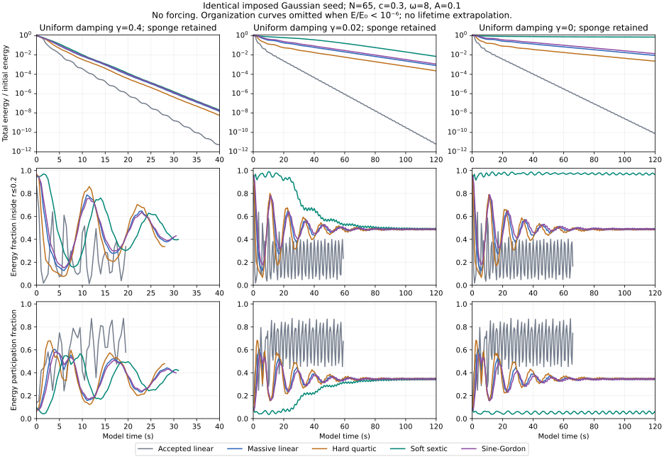
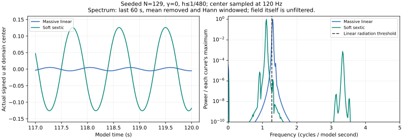

# Issue #3 — bounded nonlinear field research

2026-11-03 · [Issue #3](https://github.com/mongstad/SENTIO/issues/3) · Research only

## Result

Recommend the **soft sextic potential** below for a separately authorized,
optional runtime experiment. With an imposed Gaussian seed, zero uniform
damping, and the existing absorbing sponge, it retained approximately 71% of
initial energy over the last 20 of 120 model seconds; approximately 97% of the
remaining energy stayed inside radius 0.2. Matched massive linear and other
nonlinear controls dispersed substantially more. Grid, step, and larger-domain
checks preserve this difference. A central frequency below the linear radiation
threshold supports an oscillon-like interpretation, not an infinite lifetime.

**The sensory-like forcing tests did not establish spontaneous persistent
structure.** At the nominal damping of 0.4, seeds and removed-input responses
decayed. At damping 0.02 the sextic seed eventually became diffuse ringdown.
This result does not demonstrate recognition, memory, learning, or an optical
reconstruction. It justifies investigating one specified dynamical model.

The application, CLI, UI, camera, dependencies, checkpoints, original tests,
and historical validation evidence are unchanged. No nonlinear runtime mode,
new live window, camera experiment, or GPU work was performed for this issue.

## Models and numerical contract

The baseline is merged PR #2, commit
`46f90e22dcb75b7f8a6db268b22038c882f3277b`. Its invariants are float64 signed
amplitude and aligned velocity, additive forcing of continuing state, five-point
Laplacian, fixed zero edges, the quadratic sponge, and exact damping split around
velocity Verlet. Its wave step obeys `c h/dx ≤ 0.8/√2`, with `h ≤ 1/240`.
[MODEL.md](MODEL.md) remains authoritative for the application. The isolated
research subclass calls the actual accepted step implementation for `V=0`;
tests confirm identical arrays at N=33 and N=256. Research checkpoint methods
reject use rather than labeling nonlinear state as an application checkpoint.

All research models use

```text
u_t = v
v_t = c² Δu − (γ + σ)v + κS − V'(u),  q = u/A
```

Coordinates have model-length units; time is model seconds, unrelated to camera
exposure. `u` is a dimensionless field amplitude, `A` has the same amplitude
scale, `ω` is inverse model seconds, `c` is model length/time, `γ,σ` are inverse
time, and `κS` is amplitude/time². `V` has amplitude²/time² units. There is no
calibration to physical optical energy.

| Model | Local potential V / (ω²A²) | Expected effect and constraint |
|---|---|---|
| Accepted linear control | 0 | Propagation/interference without local self-interaction |
| Massive linear control | q²/2 | Separates the added linear restoring frequency from nonlinear effects |
| Hard quartic | q²/2 + q⁴/4 | Bounded below; hardening raises local frequency, favoring radiation rather than soft localized oscillation |
| Soft sextic | q²/2 − q⁴/4 + 0.3q⁶/6 | Softening at moderate amplitude; positive sixth-order term confines large amplitude; candidate for localized oscillation |
| Sine-Gordon | 1 − cos(q) | Softening, bounded periodic potential; local energy does not confine arbitrarily large amplitude |

The sextic potential has one minimum: `u V'(u) ≥ 0` and
`V ≥ (3/16)ω²u²`. It does not encode a spatial shape or competing preferred
regions. Its local curvature can be negative; ensuing physical growth must be
distinguished from an integration instability. Sine-Gordon has multiple vacua;
fixed-wall gradient energy still matters even though its local potential is
bounded above. None of these facts proves persistence of an arbitrary seed.

Prior numerical work found localized oscillations in 2D scalar models, including
sine-Gordon, but under different potentials, seeds and boundaries. The quartic
model in that work is a **double-well**, unlike our hard quartic control.
[Hindmarsh and Salmi (2006)](https://arxiv.org/abs/hep-th/0606016).
Radiation studies motivate looking for a softened fundamental below the linear
mass threshold, while higher harmonics can still radiate in two dimensions.
[Fodor et al. (2009)](https://arxiv.org/abs/0903.0953). The findings here are
independent finite-duration measurements, not transferred lifetime claims.

The additional fixed step bound is

```text
h ≤ min(1/240, 0.8 dx/(√2 c), 1.6/√(8c²/dx² + B))
B ≥ |V''| throughout the declared amplitude envelope
```

For `|q|≤Q=4`, the polynomial bounds are `ω²(1+3Q²)` and
`ω²(1+3Q²+1.5Q⁴)`. Massive and sine-Gordon use the global bound `B=ω²`.
Polynomial envelope excursions stop atomically without clipping. Every step
checks finiteness and the existing magnitude guard. These are safeguards, not
a proof of nonlinear stability or certification of every allowed setting.

Energy adds `dx² ΣV(u)` to the accepted discrete kinetic/edge-gradient energy.
The continuum/semi-discrete balance is input work minus damping loss. The
harness accumulates exact held-source work `κ dx² Σ S Δu` and exact kinetic
loss at both damping substeps. The residual
`R = E(t) − E(0) − W(t) + D(t)` measures integration error. Reported relative
residuals divide the maximum sampled `|R|` by
`max(E(0), max sampled |W|, 1e−30)`; energy is not claimed to be exactly conserved.

## Executed protocol and diagnostics

CPU NumPy 2.4.3, Python 3.14.8, Fedora 44/kernel 7.2.14. Default research settings:
`c=.3, κ=2, ω=8, A=.1`, unit square, N=65, sponge retained, diagnostics every
0.5 model seconds. Synthetic sources reuse the accepted input functions, held
at 30 model Hz with steps aligned to source changes. There is no RNG or webcam.

Initial arrays are identical between models; their energies differ because
their potentials differ. Retention is normalized to each model's own initial
energy, not presented as an equal-energy comparison. The explicitly imposed
seed is `u=1.2A exp(−r²/.15²), v=0`; the impulse is
`u=0, v=ωA exp(−r²/.06²)`. Both are centered and edge-zeroed. Cessation removes
the stationary source at t=5 without resetting state.

The [protocol and full commands](../research/issue_3/README.md) specify 40 nominal
comparisons (zero/impulse/seed/stationary/moving/viewpoint/recurring/cessation,
40 s), 15 weakly damped long runs (120 s), five strong uniform-forcing runs,
16 boundary/refinement runs, eight one-factor sextic variations, and five N=256
cessation runs (10 s). After inspecting that matrix, 17 explicitly labeled
follow-up seed runs removed uniform damping and refined the grid/domain.
**All 106 comparisons completed without a guard stop.** Separate convergence,
energy-balance and two central-frequency runs supplement them.

Besides signed extrema, RMS amplitude and energy, the diagnostics are:

- **Core fraction:** energy inside a fixed physical radius 0.2 divided by total
  energy; the centered seed makes this a seed-retention diagnostic, not a general
  object detector. Each gradient edge's energy is split between its endpoints.
- **Participation fraction:** `(Σe)² / (N² Σe²)` for nonnegative local energy
  density `e`; small values mean energy occupies a smaller fraction of the box.
  Its fraction changes with box area, so compare physical area as well as fraction.
- **Spatial spectrum:** fixed-wall DST-I amplitude power, radial bands ≤4,
  4–12, and >12 cycles/model length, plus power-weighted RMS spatial frequency.
  This is amplitude power, not an energy spectrum. Fractions become meaningless
  as the field vanishes; null thresholds are recorded in the code.

No field normalization or image enhancement changes the simulation. The plots
use common axes. Organization curves below `E/E₀=1e−6` are omitted explicitly;
scalar evidence retains those measurements. Peaks are sampled, while guards
run on every step. Late means cover the last 20 s (last half for runs under 40 s).

## Measured comparisons

For the unforced seed at N=65, γ=0, with sponge, late means over t=100…120 are:

| Model | E(120) | Mean E/E₀ | Mean core fraction | Mean participation |
|---|---:|---:|---:|---:|
| Accepted linear | 1.651e−13 | 7.38e−10 | Below useful amplitude | Below useful amplitude |
| Massive linear | 1.629e−4 | 0.01275 | 0.4885 | 0.3455 |
| Hard quartic | 5.509e−5 | 0.003266 | 0.4871 | 0.3466 |
| Soft sextic | 9.552e−3 | 0.7085 | 0.9701 | 0.05299 |
| Sine-Gordon | 2.363e−4 | 0.01942 | 0.4896 | 0.3446 |



At γ=.02 the sextic seed has core fraction 0.990 at t=10, but only 0.487 at
t=120. Its late participation 0.343 is close to the massive control's 0.346:
remaining energy alone would misleadingly suggest retained localization.
At γ=.4 all seeded final energies are below 3.1e−10 at t=40. Zero-input fields
remain exactly zero in all five models.

Nominal forced responses are mostly weakly nonlinear. At t=40, stationary
energies for massive/quartic/sextic/sine-Gordon are respectively
`1.796e−4 / 1.777e−4 / 1.816e−4 / 1.799e−4`; moving-source values are
`9.136e−4 / 8.893e−4 / 9.383e−4 / 9.177e−4`. The accepted massless values
are `9.242e−4` and `5.336e−3`. Similar total energy does not imply identical
fields, but a large difference from the massless baseline cannot by itself be
attributed to nonlinearity. After cessation, all final energies are below
2.7e−12 at t=40. These forced patterns do not demonstrate autonomous retention.

Continuous-forcing stress results remain finite over the observed windows:

| Model | Uniform κ=20, γ=.4: sampled peak through 40 s | Massive-resonant κ=2, γ=.02: E(120) |
|---|---:|---:|
| Accepted linear | 25.44 | 0.004897 |
| Massive linear | 0.6106 | 73.39 |
| Hard quartic | 0.2207 | 0.08026 |
| Soft sextic | 0.2814 | 0.1119 |
| Sine-Gordon | 25.32 | 0.5238 |

The resonant drive is the first box sine mode at the continuum massive-mode
frequency. It deliberately exposes linear resonance and nonlinear detuning;
it is not a typical camera claim. Sine-Gordon's periodic local potential permits
large amplitude excursions under strong DC forcing. The sextic run stays inside
its ±0.4 envelope. No finite run establishes boundedness for arbitrary forcing
or infinite duration. The largest sampled relative balance residual in the
40-run nominal screen is 6.72e−4; strong uniform stress reaches 1.48e−3.

## Refinement, boundaries and mechanism

With no forcing/damping/sponge, the t=2 state difference combines RMS `u` and
`v/ω`, normalized by the finer state's corresponding norm. Halving time steps
reduces successive differences by 4.000–4.004 across all five models.
Spatial refinement at N=33/65/129 gives reductions
`3.94 / 3.95 / 3.78 / 2.65 / 4.06` in table order. **N=33 underresolves the
sextic seed.** Follow-up N=64/127/253 improves its reduction to 3.64; successive
relative state differences are 0.05815 and 0.01599. This approaches second
order but is not a claim of exact spatial convergence at the coarse grid.

Four-second energy-balance checks, both unforced conservative and
stationary/forced/damped, reduce residuals approximately fourfold when the
step is halved. Coarse relative residuals range from 3.36e−5 to 4.46e−4.

Long sextic seed checks at γ=0, with sponge:

| N / box length / maximum step | E(120) | Late core fraction |
|---|---:|---:|
| 65 / 1 / 1⁄240 | 0.00955165 | 0.97010 |
| 129 / 1 / 1⁄240 | 0.00957607 | 0.97023 |
| 129 / 1 / 1⁄480 | 0.00957710 | 0.97026 |
| 253 / 1 / 1⁄480 | 0.00958608 | 0.97015 |
| 129 / 2 / 1⁄240 | 0.00962559 | 0.96858 |

Doubling the box moves the wall/sponge away, keeping dx and the physical seed
width matched to N=65/L=1; the sponge's physical width also doubles. Retention
changes little for the sextic seed, whereas the massive control's late retention
changes from 0.01275 to 0.08342. Sponge-free, γ=.02 controls retain much more
energy even in the massive linear model: boundary ringing can mimic longevity.
The domain test supports localization here, not a universal reflection bound.

Late sextic high-band amplitude power drops from 3.59e−4 at N=65 to 1.61e−5 at
N=253/h≤1⁄480. RMS spatial frequency changes from 2.020 to 1.846 cycles/length.
Fine spectral detail is less converged than core-energy retention; near a zero
crossing, normalized amplitude spectra are especially sensitive. No cascade or
scale-invariant structure is claimed.

The separate N=129, h≤1⁄480 center trace is sampled at 120 Hz. Over t=60…120,
the sextic dominant frequency is 1.1167 cycles/model second versus the massive
control's 1.3000. The continuum radiation threshold is `ω/(2π)=1.27324`;
frequency-bin spacing is 0.01667. This supports softening below the linear
threshold; visible higher harmonics and finite energy loss preclude declaring
an exact breather. Mean removal/Hann windowing and per-curve power normalization
apply only to this diagnostic, not the signed field trace.



## Recommended next step and limits

If the owner authorizes a runtime issue, add only the soft sextic as an optional
mode and retain the accepted linear default. Begin with the tested preset
`ω=8, A=.1, c=.3`, sponge on, N=256, source constrained to `[-1,1]`, and the
wave/potential bound additionally capped at `h≤1/480`. Use `κ=0` for seed controls,
`κ=2` for nominal forcing, and γ in `[0,.4]` as a proposed experimental damping
range (only 0, .02 and .4 were sampled). Enforce `|u|≤.4` by faulting without
clipping. These are conservative starting constraints, not a certified Cartesian
safe region or permission to alter current UI ranges.

One-factor variations at ω=6/10, A=.075/.15, seed ratio=.8/1.6 and width=.12/.18
all completed 60 s at γ=.02. Their results depend on seed/scale; they do not
validate every combination or sensory-driven formation. Changing A while scaling
the unforced seed with A is a scaling symmetry, not independent robustness proof.

Before runtime acceptance, require full-grid long forced/cessation tests at that
preset and finer step, high-frequency/checkerboard source and larger-amplitude
guard tests, live parameter-change work accounting and atomic rejection,
model-specific checkpoint validation, throughput/latency measurement, actual
camera and window tests, and repeated matched input/no-input controls. Extend
duration and challenge localization with displaced/asymmetric seeds and domain
checks before making broader persistence claims. None was performed here beyond
the specific matrix above. No nonlinear real-time performance is certified.

## Verification and owner reproduction

The [compact scalar evidence](evidence/issue-3/summary.json) includes all 106 case
settings, signed final diagnostics, selected checkpoints, late means, residuals,
final-state hashes, source hashes, environment and convergence/frequency results.
The two SVG plots and summary together occupy less than 600 kB. Full scalar logs stay
in ignored `runs/`; no frame data or binary field checkpoints are committed.

| Validation actually performed | Result |
|---|---|
| Complete unittest suite, normal Python environment | 40 passed, 0 skipped, 3.572 s |
| Complete unittest suite, `PYTHONNOUSERSITE=1` | 40 passed, 0 skipped, 3.591 s |
| Original tests | All 27 unchanged; 13 additional research tests cover potentials, numerical balance, exact baseline equivalence, deterministic continuation, guards and diagnostics |
| Actual headless application, recurring source, requested 5 wall seconds | 1,196 steps / 4.98333 model seconds; finite, no fault, no skipped wall time; median 239.592 steps/s after warmup |
| GUI regression within the suite | Offscreen Qt widget interaction, pause/hot controls/reset/shutdown and signed rendering passed; no new physical desktop or camera validation |
| Research matrix and artifacts | 106 completed comparisons; no stop; both scientific figures rendered and visually inspected |

The first attempted parallel research launch failed before executing cases
because Python 3.14's default forkserver needed a socket unavailable in the
sandbox. Explicit multiprocessing `spawn` resolved the execution issue. No
numerical run was discarded as a consequence. The intentionally stopped envelope
case is an automated guard test, separate from the 106 comparison runs.

From this checkout:

```bash
python3 -m unittest discover -s tests -v
PYTHONNOUSERSITE=1 python3 -m unittest discover -s tests -v
python3 -m sentio --headless --source recurring --seconds 5 --report /tmp/sentio-review.json --log /tmp/sentio-review.jsonl
```

For numerical reproduction, use the exact commands in the
[research protocol](../research/issue_3/README.md) with a new output directory.
Inspect guard outcomes before comparing metrics. Final-state hashes support
repetition in the same environment; exact bits across NumPy/platform versions
are not promised. The baseline's [camera procedure](EXPERIMENTS.md) remains
available for optional owner regression review; this issue did not retest hardware.
